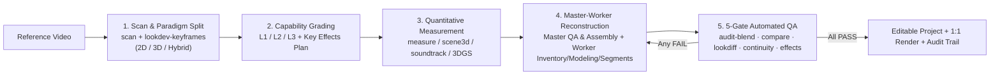

<p align="center">
  
</p>

# H2O Video Decompose

[简体中文](README.md) | **English**

> Reference Video → Frame-Accurate Quantitative Decompose → Master-Worker Editable Reconstruction → 5-Gate Automated QA

A video decomposition and editable reconstruction skill for Codex and other subagent-capable AI agents. Instead of letting a multimodal model eyeball a clip and guess its way through a remake, this skill first measures cuts, trajectories, 3D camera/lighting/materials, and audio stems with reproducible computer-vision and signal-processing scripts, orchestrates reconstruction through a **Master-Worker agent pipeline** targeting **Blender / After Effects / Remotion**, and verifies every deliverable through **headless `.blend` static auditing + pixel/temporal QA gates**.

---

## Read Before Using (Strongly Recommended)

> [!IMPORTANT]
> 1. **Run in Plan Mode**: For reconstruction tasks, strongly prefer **Plan Mode**. This lets the agent scan the video, classify capability boundaries, and align technical route, fidelity tier, replacement assets, and subagent configuration up front—before spending time modeling or rendering in the wrong direction.
> 2. **No Built-in Motion, Material, Model, or Font Libraries**: This repository contains analysis scripts, orchestration rules, and QA gates only—**it ships with zero preset libraries or asset packs**. If you know which motion template, PBR material, texture, 3D asset, or font the target video uses—and you already have it—**hand it directly to the agent**. Reusing your existing assets is dramatically faster and more accurate than rebuilding everything from scratch.
> 3. **Explicitly Specify the Subagent Model**: Reconstruction enforces **Master-Worker orchestration** (single-agent reconstruction is disabled). Normally the skill asks you to confirm subagent model, reasoning effort, and concurrency cap during onboarding. **If the agent does not explicitly ask you which model to use for subagents, instruct it directly**—do not let the host silently fall back to a lightweight model, which severely degrades modeling and per-segment quality.
> 4. **Human-in-the-Loop Revision Is Required for Complex, High-Detail Remakes**: This skill is not a one-click fully autonomous magic button. When the target video is complex and you want very fine-grained fidelity, **you need to step in during review rounds—pointing out specific timestamps, visual mismatches, and art-direction priorities to guide targeted revisions**. Every deliverable is kept fully editable specifically to support iterative human-guided refinement.

---

## Architecture Overview



---

## Capabilities & Deliverables

| Workflow | What You Get | Collaboration Mode |
| --- | --- | --- |
| **Full-Video Scan & Optical Keyframing** | Storyboards, candidate cuts, frame/PTS index (VFR-safe), and `lookdev-keyframes.json` (auto-selects peak emissive/highlight, peak contrast, and low-key frames so critical lighting moments are never skipped). | Direct by Master for pure analysis |
| **2D / 2.5D Motion & Typography Measurement** | Similarity/affine/homography camera fits, layered trajectories, entrance/overshoot timing, 10–90% zoned sharpness, glyph contour IoU, layout metrics, and color palettes → Remotion / AE / Canvas. | Direct for analysis; Master-Worker required for remake |
| **3D Scene Inversion & Look-Dev** | Perspective/ortho focal length & pose, per-object 3D coordinates & material BOM, roughness & multi-scale texture spectra, **19 evidence-gated look-dev switches** (including indirect emissive spill, volume fog, oriented glossy reflections, dual-scale bloom), and machine-readable render requirements → Blender. | Direct for analysis; Master-Worker required for remake |
| **Audio Decomposition & Beat Alignment** | Aligned original mix, Bandit v2 + ELUATE 3-stem separation (dialogue / music / SFX), Beat This! beat candidates, `av_beat_lock` AV sync table, and listening clips. | Master or delegated as needed |
| **Static Photoreal 3DGS (Optional)** | Local `COLMAP` → `Brush` pipeline with translation-baseline safety analysis, exporting a Blender-ready `.ply` (rigid static-light scenes only). | Opt-in after boundary check |
| **5-Gate Closed-Loop QA** | Headless `.blend` static audit (`audit-blend`) + bidirectional pixel/gate judge (`compare --strict`) + native-scale local appearance diff (`lookdiff`) + frame-by-frame motion/occlusion continuity (`continuity`) + per-effect verification (`effects`). | Independent final QA by Master |

---

## Three Non-Negotiable Engineering Rules

1. **Master-Worker Only for Reconstruction (Single-Agent Disabled)**
   - Running inventory, modeling, multi-shot animation, and QA inside one agent context leads to drift and self-grading bias. Reconstruction strictly splits responsibilities: the **Master** owns scanning, boundary checks, shared asset verification, final assembly, and end-to-end QA; dedicated **Workers** own asset inventory, single-owner modeling, and per-segment reconstruction (defaulting to **Fine** tier: max 2 seconds per worker, owning measurement through revision).
   - Tight host concurrency slots queue workers serially (down to concurrency `1`); if the host cannot spawn subagents at all, reconstruction halts and informs the user rather than silently falling back to single-agent mode.
2. **Zero Speed-Compromise Rendering + Headless `.blend` Audit (`audit-blend`)**
   - Downgrading render engines, turning off raytracing/GI, zeroing bounces, dropping volumetrics, or crushing samples just to render faster is strictly prohibited for final QA/delivery renders.
   - Under physics-driven **Policy A**, scenes with measured emissive indirect spill, volume fog, or complex specular/wet/glass reflections require **Cycles** with adequate bounces and denoising; **EEVEE with `use_raytracing = False` is banned for any non-flat 3D delivery**. `audit-blend --strict` inspects the `.blend` headlessly in ~1 second to block silent downgrades and warn on oversized flat-wash fill lamps or shader cheats.
3. **No Raw Source Pixels in Parametric Remakes**
   - Parametric 2D/3D projects must never embed raw frames, crops, or cutouts from the reference video. Deliverables are gated against real exported frames via `compare --strict`, `lookdiff`, `continuity`, and `effects`—enforcing every measured source effect without hallucinating absent ones.

---

## Capability Boundaries: What It Can and Cannot Do

Pure **decomposition / analysis** works on almost any video. For **1:1 editable reconstruction**, shots are graded upfront against the full [Capability Matrix](h2o-video-decompose-distribution/references/capabilities.md) *(in Chinese)*:

| Tier | Scope | Notes |
| --- | --- | --- |
| 🟢 **L1 High-Precision Editable Remake** | 2D/2.5D UI & motion graphics, typography/page animations, hard-surface/architectural/modular/voxel/studio 3D, standard PBR/NPR, `2D over 3D` composites, original audio alignment | Core sweet spot with full parameterized rebuild and automated QA |
| 🟡 **L2 Asset or Condition Verification Required** | Moderately organic props or curved vehicles, simple/blocky characters, procedural water/rain/foliage, strong caustics, custom fonts/vectors; static rigid-light 3DGS | **Provide existing models, materials, fonts, or motion presets directly if you have them**; 3DGS safe novel views are strictly bounded by camera translation baseline |
| 🔴 **L3 Out of Current 1:1 Scope** | **Live-action human performances & facial micro-expressions, traditional frame-by-frame hand-drawn 2D anime/animation, cinematic rigged creatures with hair/cloth sim, heavy physics VFX (fluids/fire/explosions/destruction/cloth), dolly-zoom / FPV freestyle / pure organic aerials without straight geometry, Class-A automotive/luxury surfaces, severe lens distortion/glitch/strobe/full-frame blur, heavily flickering AI-generated videos, original music recomposition or voice acting** | Outside current high-precision editable reconstruction limits; still fully supported for shot, timing, and AV analysis |

> **Reminder**: This skill **does not bundle any motion preset packs, PBR material libraries, 3D model libraries, or fonts**. Supplying any known assets up front saves substantial time and improves fidelity.

---

## Quick Start

### 1. Install the Skill

Run in your project directory:

```bash
npx skills add Poseima/h2o-video-decompose --skill h2o-video-decompose-distribution
```

Alternatively, clone this repository and copy `h2o-video-decompose-distribution` into your host's custom skills directory.

### 2. Install Dependencies

Supported on **macOS (Apple Silicon)** and **Windows 11 (x64)**. Linux is not currently supported.

| Tier | Components | Used For | Verified Platforms |
| --- | --- | --- | --- |
| **Base (Required)** | Python 3.12 + FFmpeg (`libx264`) + `scripts/requirements.txt` | `scan`, `measure`, `scene3d`, `compare`, `audit-blend`, `lookdiff`, `continuity`, `effects` | Verified on macOS & Windows 11 |
| **Audio (Optional)** | PyTorch 2.8 + `scripts/requirements-audio.txt` + Bandit v2 / Beat This! checkpoints | Dialogue / music / SFX separation & beat tracking | Verified on macOS; pending on Windows |
| **3DGS (Optional)** | COLMAP 4.2+ + Brush CLI (+ Blender & KIRI addon) | Local Gaussian Splatting for static photoreal scenes | Verified on macOS; pending on Windows |

See [INSTALL.md](h2o-video-decompose-distribution/INSTALL.md) *(in Chinese)* for step-by-step setup, offline installation, and smoke tests.

### 3. Prompt Your Agent (Prefer Plan Mode)

**Example A — Pure Video & Audio Analysis**

```text
Use $h2o-video-decompose-distribution to decompose video.mp4.
Deliver the full shot timeline, cut list, motion timing, SFX/music cue alignment, and listening clips.
```

**Example B — 2D / UI Motion Reconstruction (in Plan Mode)**

```text
Use $h2o-video-decompose-distribution to reconstruct 00:02–00:08 of video.mp4 as an editable Remotion project.
Start in Plan Mode to confirm the route, tier, subagent model, and concurrency.
I already have the project fonts and brand assets in ./assets/—reuse them directly.
```

**Example C — 3D Blender Reconstruction (in Plan Mode with Explicit Subagent Model)**

```text
Use $h2o-video-decompose-distribution for a 1:1 editable Blender reconstruction of 00:15–00:26 of video.mp4.
Run scanning, capability grading, and asset inventory in Plan Mode first.
If not asked separately, use <your-strong-model> (high reasoning effort) for all subagents with max concurrency 3.
```

---

## Built-in CLI Toolkit

All scripts live under `h2o-video-decompose-distribution/scripts/` and can be invoked by the agent or directly from the terminal:

| Command | Purpose |
| --- | --- |
| `python scripts/decompose.py scan <video> <out_dir>` | Scan video, generate storyboards, candidate cuts, and optical-regime `lookdev-keyframes.json` |
| `python scripts/decompose.py measure <video> <out_dir> --scan <source.json> --plan <plan.json>` | 2D/2.5D frame registration, homography/affine motion fits, and zoned 10–90% sharpness |
| `python scripts/decompose.py scene3d <video> <out_dir> --frame <idx>` | 2D/3D paradigm detection, camera/material/lighting/19-gate/object-BOM inversion & render requirements |
| `python scripts/decompose.py compare <orig_scene3d.json> <render_scene3d.json> --strict --out <dir>` | Bidirectional pixel & look-dev gate judge (19 gates, photometry, emissive spill, 4-quadrant contrast, anti-cheat texture checks, SSIM heatmap) |
| `python scripts/decompose.py audit-blend <file.blend> --scene3d <orig_scene3d.json> --strict --out <dir>` | Headless `.blend` static audit (blocks no-RT EEVEE downgrades, low bounces/samples, missing volume/glare; warns on flat-wash fill lamps & shader cheats) |
| `python scripts/decompose.py lookdiff <ref_video> <replica_video> <out_dir>` | Shot-by-shot native-pixel local appearance diagnostics |
| `python scripts/decompose.py continuity <ref_video> <replica_video> <out_dir>` | Frame-by-frame continuity gate (jitter, camera jumps, flashes, freezes, occlusion tracking) |
| `python scripts/decompose.py effects <ref_video> <replica_video> <effects_plan.json> <out_dir>` | Per-effect verification across motion, perspective, focus, trails, visibility, and AV hits |
| `python scripts/soundtrack.py prepare \| match \| beat-lock` | Original mix extraction, 3-stem separation, beat detection, AV offset calculation & beat lock |
| `python scripts/gs3d_pipeline.py --video <video> --out-dir <dir> --stage all` | Rigid-frame extraction, COLMAP SfM, baseline analysis, and Brush 3DGS training |

---

## Repository Layout & Documentation

```text
h2o-video-decompose/
├── README.md                                  # Chinese README
├── README.en.md                               # English README (this file)
├── assets/banner.gif                          # Header banner GIF
└── h2o-video-decompose-distribution/
    ├── SKILL.md                               # Skill entrypoint & core rules
    ├── INSTALL.md                             # macOS / Windows tiered setup & smoke tests
    ├── agents/openai.yaml                     # Agent UI metadata
    ├── scripts/                               # Decompose, 3D inversion, .blend audit, audio & QA scripts
    ├── references/                            # Capability matrix, workflow manual, QA specs & cases
    └── tests/                                 # Multi-genre & QA unit tests
```

- [Skill Entrypoint (`SKILL.md`)](h2o-video-decompose-distribution/SKILL.md)
- [Installation & Verification (`INSTALL.md`)](h2o-video-decompose-distribution/INSTALL.md)
- [Capability Matrix (`capabilities.md`)](h2o-video-decompose-distribution/references/capabilities.md)
- [Workflow Manual & Parameters (`workflow.md`)](h2o-video-decompose-distribution/references/workflow.md)
- [Key Effects Verification (`effects.md`)](h2o-video-decompose-distribution/references/effects.md)
- [Shot Continuity Gate (`continuity.md`)](h2o-video-decompose-distribution/references/continuity.md)
- [Local Appearance Diagnostics (`local-appearance.md`)](h2o-video-decompose-distribution/references/local-appearance.md)
