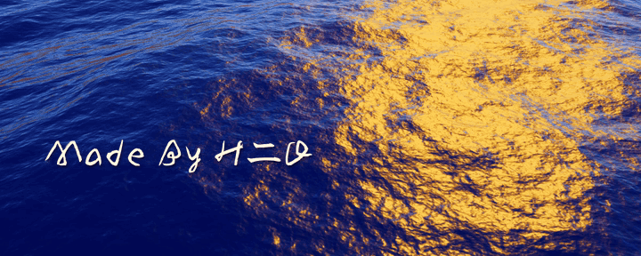

<p align="center">
  
</p>

# H2O Video Decompose

**简体中文** | [English](README.en.md)

> 参考视频 → 定量逐帧拆解 → 主从 Agent 可编辑复刻 → 五道自动验收门禁

面向 Codex 等支持子代理的 AI Agent 的视频拆解与可编辑复刻 Skill。相比让多模态模型“肉眼看一眼视频再凭感觉重写”，本工具先通过可复算的计算机视觉、三维反演与音频信号脚本把参考视频拆成定量数据，再由 **主从 Agent** 接入 **Blender / After Effects / Remotion** 重建，最后用 **工程静态审计 + 像素/时序红灯门禁** 逐项核验成片。

---

## 使用前必读（强烈建议）

> [!IMPORTANT]
> 1. **推荐使用「计划模式（Plan Mode）」执行**：尤其在复刻任务中，开启计划模式可让 Agent 先完成扫查、能力边界预检与开工问卷，把技术路线、复刻档位、资产替换与子代理配置一次确认清楚，再真正派工建模与渲染，避免中途跑偏返工。
> 2. **不包含任何内置动效库、材质库、模型库或字体库**：本 Skill 只提供拆解脚本、工作流与质检门禁，**不自带现成素材包**。如果你知道目标视频具体用了哪套动效预设、PBR 材质、贴图、3D 模型或字库，且你手头正好有，**直接把资源交给 Agent 会快得多、还原度也更高**，不必让它全部从零复刻。
> 3. **务必确认子 Agent 的具体模型**：复刻强制采用主从 Agent 协作模式（已禁用单 Agent 复刻）。正常情况下 Skill 会在开工问卷里向你确认子 Agent 的模型、推理强度和并发上限；**如果 Agent 没有主动和你确认子 Agent 具体用什么模型，请直接明确指示**，避免宿主静默落到轻量模型导致建模与分段质量大幅下降。
> 4. **复杂视频要做到极致细节，需要人工参与指导返修**：本 Skill 并非“全自动一键出神片”。对于镜头长、层级多、光影或造型复杂的目标视频，如果你想达到非常精细的还原度，**需要你在审片对照环节人工介入，指出具体时段和视觉差异并指导 Agent 针对性返修**；所有工程均保持完全可编辑，就是为了支持多轮人机协同精修。

---

## 工作原理


---

## 核心能力与交付物

| 工作流 | 说明与交付物 | 协作模式 |
| --- | --- | --- |
| **全片扫查与光学选帧** | 故事板、候选切点、源帧索引（VFR 按真实 PTS 对齐）及 `lookdev-keyframes.json`（自动覆盖强光/发光峰值、高反差与暗调代表帧）。 | 纯拆解可由总负责人直接完成 |
| **2D / 2.5D 动效精测** | 单应性/仿射/相似投影矩阵、分层轨迹、入场与回弹时序、10–90% 分区清晰度、字体轮廓 IoU、版式尺寸与色板 → 可接入 Remotion / AE / Canvas。 | 拆解直出；复刻强制主从 Agent |
| **3D 场景逆向与 Look-Dev** | 透视/正交焦距与位姿、逐物件 3D 坐标与独立材质 BOM、粗糙度与三尺度肌理、**19 项证据驱动门控**（含自发光间接溢光、体积雾、斜向光泽反射、双层辉光等）与机器可读渲染硬要求 → 接入 Blender。 | 拆解直出；复刻强制主从 Agent |
| **声画拆解与节拍对齐** | 原混音提取、Bandit v2 + ELUATE 三轨分离（对白 / BGM / 音效）、Beat This! 节拍候选、`av_beat_lock` 声画卡点表与同步试听。 | 总负责人或按需分工 |
| **写实静态场景 3DGS（可选）** | `COLMAP` → `Brush` 本地训练与基线安全视角评估，导出可导入 Blender 的 `.ply`（需刚体静光段，受相机平移基线约束）。 | 按需启用并前置确认边界 |
| **五道闭环验收门禁** | `.blend` 工程静态审计（`audit-blend`）+ 像素双向裁判（`compare --strict`）+ 原尺寸局部质感诊断（`lookdiff`）+ 逐帧连续性验收（`continuity`）+ 逐项重点效果复核（`effects`）。 | 总负责人独立终验 |

---

## 为什么复刻质量可控：三条工程红线

1. **强制主从 Agent 分工（禁用单 Agent 复刻）**
   - 单 Agent 兼顾分析、建模、全段动画与验收时上下文极易污染且容易自我放水。本 Skill 仅保留主从模式：总负责人专职扫查、能力预检、共享资产核验发布、总装与整片终验；盘点、唯一负责制建模与分段制作（默认推荐「精细复刻」，每段 ≤ 2 秒）由独立子代理闭环负责。
   - 并发名额紧张时允许最低并发 `1` 的独立子代理串行排队接力；若宿主不支持创建子代理，复刻会直接阻断提示，不会静默退回单 Agent。
2. **零渲染妥协 + `.blend` 工程静态审计（`audit-blend`）**
   - 绝对禁止为了渲得更快而在正式验收/交付成片中暗中降级渲染引擎、关闭光追、砍掉弹射、删体积雾或压低采样。
   - 按原片物理光传输需求分级（方案 A）：原片实测包含自发光间接溢光、体积散射或复杂镜面/湿面/透明反射时，终稿强制使用 `Cycles` 并校验弹射与降噪；任何非平面 3D 终稿一律禁止使用关光追的 `EEVEE`。`audit-blend --strict` 约 1 秒无头开工程直检上述硬伤，并对超大泛光洗平与材质作弊发出预警。
3. **禁止原片像素混入 + 多维红灯复测**
   - 参数化复刻工程与成片严禁直接使用原片片段、截图、裁切或抠图。成片必须过 `compare --strict`、`lookdiff`、`continuity` 与 `effects`，原片没有的特效不得硬加，原片实测有的维度不得漏装。

---

## 能力边界：能做什么、明确做不到什么

复刻开工前会先对照完整[能力边界矩阵](h2o-video-decompose-distribution/references/capabilities.md)逐镜定级；**纯「拆解 / 分析」几乎支持所有视频**，但 **1:1 可编辑复刻** 的明确边界如下：

| 等级 | 适用场景 | 说明 |
| --- | --- | --- |
| 🟢 **L1 高精度可编辑复刻** | 2D/2.5D UI 动效、白页打字与排版、硬表面/建筑/模块化/体素/棚拍 3D 场景、标准 PBR/NPR、三维底景叠加 2D 字幕（`2D over 3D`）、原混音对齐 | 核心强项，支持参数化 1:1 重建与全套自动验收 |
| 🟡 **L2 需先核验资产或条件** | 中等复杂有机道具或曲面载具、简模/方块角色、程序化水面/雨雪/简单植被、强折射焦散材质、特殊字库/矢量稿；以及刚体静光静态场景的 3DGS | **手头有对应模型/材质/字库/动效预设请直接提供给 Agent**；3DGS 的安全新视角严格受原片相机平移基线约束 |
| 🔴 **L3 当前做不到高精度复刻** | **实拍真人表演与口播微表情、传统手绘逐帧 2D 动画（番剧/作画形变）、影视级写实角色/生物绑定与毛发布料、重度物理 VFX（流体/烟火/爆炸/破碎/布料）、动态变焦 Dolly Zoom / FPV 穿越机与无人工直线的纯有机航拍、汽车/奢侈品 A 级曲面、强非线性畸变/重度 Glitch/高频闪切或整帧严重模糊、剧烈闪烁的 AI 生成视频、非原声重制作曲/配音** | 超出当前高精度可编辑复刻边界；这类视频可正常做镜头、节奏与声画拆解分析，但请勿预期 1:1 复刻 |

> **再次提醒**：本仓库**不含任何现成动效库、材质库、模型库或字体库**。如果你清楚原片使用的插件预设、材质球或资产且本机已有现成文件，请在一开始就直接交给 Agent 复用。

---

## 快速开始

### 1. 安装 Skill

在你的项目目录运行：

```bash
npx skills add Poseima/h2o-video-decompose --skill h2o-video-decompose-distribution
```

也可以克隆本仓库后，将 `h2o-video-decompose-distribution` 目录复制到宿主的自定义 Skill 目录。

### 2. 安装运行依赖

支持 **macOS（Apple Silicon）** 与 **Windows 11（x64）**，暂不支持 Linux：

| 依赖层级 | 核心组件 | 适用场景 | 平台实测状态 |
| --- | --- | --- | --- |
| **基础拆解（必装）** | Python 3.12 + FFmpeg（带 `libx264`）+ `scripts/requirements.txt` | `scan`、`measure`、`scene3d`、`compare`、`audit-blend`、`lookdiff`、`continuity`、`effects` | macOS / Windows 11 均已验证 |
| **可选音频** | PyTorch 2.8 + `scripts/requirements-audio.txt` + Bandit v2 / Beat This! 权重 | 对白 / 音乐 / 音效三轨分离与自动拍点 | macOS 已验证；Windows 待实测 |
| **可选 3DGS** | COLMAP 4.2+ + Brush CLI（+ Blender 与 KIRI 扩展） | 静态写实场景高斯泼溅重建 | macOS 已验证；Windows 待实测 |

详细安装命令、离线安装与冒烟验证见 [安装与验证](h2o-video-decompose-distribution/INSTALL.md)。

### 3. 在计划模式下交给 Agent

**示例 A · 纯拆解分析（无需复刻）**

```text
使用 $h2o-video-decompose-distribution 拆解 video.mp4。
输出全片镜头时间线、切点、动效节奏、音效与配乐卡点，以及关键段试听。
```

**示例 B · 2D / UI 动效复刻（建议开启计划模式）**

```text
使用 $h2o-video-decompose-distribution 复刻 video.mp4 的 00:02–00:08，输出可编辑 Remotion 工程。
请先走计划模式确认路线、档位、子 Agent 模型与并发配置。
我本地已有项目字体和品牌素材，放在 ./assets/ 下可直接复用。
```

**示例 C · 3D Blender 复刻（建议开启计划模式并显式指明子 Agent 模型）**

```text
使用 $h2o-video-decompose-distribution 1:1 复刻 video.mp4 的 00:15–00:26，输出可编辑 Blender 工程。
请先在计划模式完成扫查、能力边界评估与资产盘点；
如未单独问卷确认，子 Agent 默认使用 <你的高能力模型名>（高推理强度），最大并发 3。
```

---

## 内置命令行工具链

以下脚本位于 `h2o-video-decompose-distribution/scripts/`，Agent 会自动调用，也可直接命令行独立运行：

| 命令 | 作用 |
| --- | --- |
| `python scripts/decompose.py scan <视频> <输出目录>` | 扫查视频、生成故事板、候选切点与光学工况关键帧 `lookdev-keyframes.json` |
| `python scripts/decompose.py measure <视频> <输出目录> --scan <source.json> --plan <plan.json>` | 2D/2.5D 逐帧配准、透视/仿射矩阵拟合与分区 10–90% 清晰度测量 |
| `python scripts/decompose.py scene3d <视频> <输出目录> --frame <帧号>` | 3D 场景范式判别、相机/材质/灯光/19 项门控/逐物件 BOM 反解与渲染硬要求输出 |
| `python scripts/decompose.py compare <原片scene3d.json> <复刻scene3d.json> --strict --out <目录>` | 双向闭环像素与门控红灯裁判（19 项门控、光度、溢光、4 象限反差、材质反作弊、SSIM/热力图） |
| `python scripts/decompose.py audit-blend <工程.blend> --scene3d <原片scene3d.json> --strict --out <目录>` | 无头 `.blend` 工程静态审计（严查无光追 EEVEE 降级、弹射/采样不足、缺体积/弱辉光与大泛光洗平） |
| `python scripts/decompose.py lookdiff <原片> <复刻> <输出目录>` | 跨视频原尺寸局部质感诊断（纹理周期/轴向、色边、轮廓宽度、亮斑对比与明暗渐变） |
| `python scripts/decompose.py continuity <原片> <复刻> <输出目录>` | 逐帧连续性门禁（运镜抖动、急停跳位、光色突变、停帧与遮挡轨迹中断） |
| `python scripts/decompose.py effects <原片> <复刻> <重点效果.json> <输出目录>` | 按原片重点效果清单逐项核对运动、透视、焦点、拖尾、显隐与声画配合 |
| `python scripts/soundtrack.py prepare \| match \| beat-lock` | 原混音提取、三轨分离、拍点检测、声画偏差计算与卡点锁定 |
| `python scripts/gs3d_pipeline.py --video <视频> --out-dir <目录> --stage all` | 刚体静态场景抽帧、COLMAP 解算、平移基线分析与 Brush 3DGS 训练 |

---

## 实测案例

- **白页打字与连续推拉（2D / 2.5D）**：从快切和页面更新中拆出打字、误选、分区清晰度与快推拖影 → [猫学长前十秒案例](h2o-video-decompose-distribution/references/cat-opening-reconstruction.md)
- **港风街景与霓虹灯牌（3D Blender）**：反解三维相机深度比、三层空心灯管高度遮罩、各向异性体积雾与合成器光学链路 → [港风三维案例](h2o-video-decompose-distribution/references/hk-neon-3d-reconstruction.md)
- **石牌坊静态场景（3DGS）**：Apple Silicon 本地 COLMAP + Brush + Blender 5.2 实测与视角锥边界分析 → [3DGS 基准](h2o-video-decompose-distribution/references/pavilion-3dgs-benchmark.md)

---

## 仓库结构与文档

```text
h2o-video-decompose/
├── README.md                                  # 中文说明（本文件）
├── README.en.md                               # English README
├── assets/banner.gif                          # 顶部展示横幅
└── h2o-video-decompose-distribution/
    ├── SKILL.md                               # Skill 主入口与核心规范
    ├── INSTALL.md                             # macOS / Windows 分层安装与冒烟验证
    ├── agents/openai.yaml                     # Agent 展示元数据
    ├── scripts/                               # 拆解、3D 反演、.blend 审计、声画与质检脚本
    ├── references/                            # 能力边界、工作手册、验收标准与案例
    └── tests/                                 # 多题材与质检单元测试
```

- [Skill 主入口](h2o-video-decompose-distribution/SKILL.md)
- [安装与验证（macOS / Windows）](h2o-video-decompose-distribution/INSTALL.md)
- [能力边界矩阵（L1 / L2 / L3）](h2o-video-decompose-distribution/references/capabilities.md)
- [使用手册、问卷流程与命令参数](h2o-video-decompose-distribution/references/workflow.md)
- [重点效果清单与逐项验收](h2o-video-decompose-distribution/references/effects.md)
- [镜头连续性验收](h2o-video-decompose-distribution/references/continuity.md)
- [局部质感诊断](h2o-video-decompose-distribution/references/local-appearance.md)
